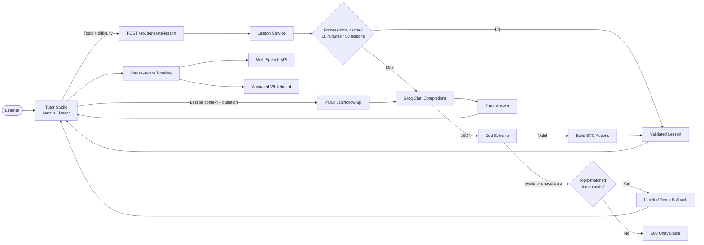
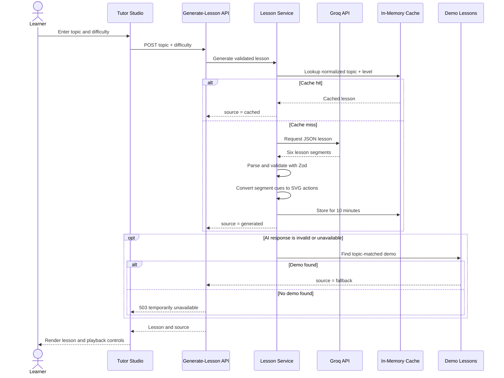
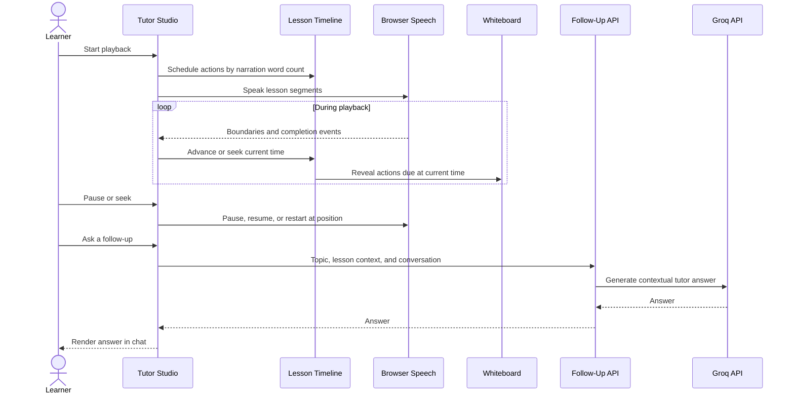
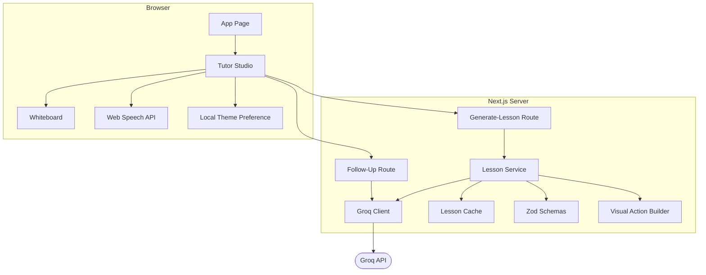

# ChalkAI

**AI-powered visual lessons with an interactive whiteboard**

ChalkAI turns a topic into a concise, narrated lesson. A learner chooses a subject and difficulty, receives a structured six-segment lesson, watches timed SVG sketches appear on the whiteboard, and can ask the tutor follow-up questions.

> The app uses Groq for lesson and follow-up generation, Zod for server-side validation, and the browser Web Speech API for narration. No audio generation or text-to-speech API key is required.

---

## Highlights

- Generate structured lessons from a topic and difficulty level
- Narrate lessons with browser-native speech synthesis
- Reveal timed SVG diagrams and text cues on an interactive whiteboard
- Pause, resume, restart, and seek lesson playback
- Draw directly on the whiteboard
- Ask follow-up questions in the context of the current lesson
- Play preloaded water cycle, black hole, and flight demos without an API key
- Cache recent AI lessons in memory for faster repeat playback
- Switch between light and dark themes

---

## How It Works



### Lesson Generation Flow



### Playback and Follow-Up Flow



---

## Architecture

| Area | Responsibility |
| --- | --- |
| `src/app/page.tsx` | Hosts the client-side `TutorStudio` experience |
| `src/components/tutor-studio.tsx` | Topic generation, chat, playback, seeking, feedback, and theme state |
| `src/components/whiteboard.tsx` | SVG lesson rendering and freehand drawing tools |
| `src/app/api/generate-lesson/route.ts` | Validates lesson requests and maps service failures to API responses |
| `src/app/api/follow-up/route.ts` | Validates chat context and requests contextual tutor answers |
| `src/services/lesson.service.ts` | Cache, Groq generation/retries, validation, demos, and fallback selection |
| `src/lib/groq.ts` | Groq HTTP client, JSON mode, model selection, and API error handling |
| `src/lib/lesson-visuals.ts` | Converts generated visual cues into whiteboard actions |
| `src/lib/lesson-timeline.ts` | Proportionally schedules whiteboard actions across narration |
| `src/schemas/lesson.schema.ts` | Runtime Zod schemas and visual-coordinate validation |
| `src/data/demo-lessons.ts` | Preloaded lessons and topic-matched fallback content |

### Component Model



---

## Tech Stack

- **Next.js 16 App Router**
- **React 19**
- **TypeScript**
- **Groq Chat Completions API**
- **Zod**
- **Web Speech API**
- **SVG and CSS**
- **Vitest**
- **ESLint**

---

## Run Locally

### Requirements

- Node.js 20 or later
- npm
- A Groq API key for live lesson and follow-up generation

### 1. Install dependencies

```bash
npm install
```

### 2. Configure environment variables

Copy the example environment file:

```powershell
Copy-Item .env.example .env.local
```

Set the Groq credentials:

```env
GROQ_API_KEY=your_groq_api_key
# Optional; defaults to openai/gpt-oss-20b
GROQ_MODEL=openai/gpt-oss-20b
```

| Variable | Required | Description |
| --- | --- | --- |
| `GROQ_API_KEY` | For AI features | Server-side Groq API key. Never expose it through `NEXT_PUBLIC_*`. |
| `GROQ_MODEL` | No | Groq model ID. Defaults to `openai/gpt-oss-20b`. |

### 3. Start the app

```bash
npm run dev
```

Open [http://localhost:3000](http://localhost:3000).

Preloaded demos work without `GROQ_API_KEY`. Live lesson generation and follow-up answers require it.

---

## Quality Checks

```bash
npm test
npm run lint
npm run build
```

The automated tests cover lesson schemas, timeline scheduling, and fallback behavior. Because browser speech timing and available voices differ by device, also validate playback in the target desktop and mobile browsers.

---

## Caching and Fallback Behavior

Successful AI lessons are cached in server memory for 10 minutes:

- The key combines normalized topic text and difficulty
- The cache retains at most 50 entries
- Expired entries are removed on lookup or insertion
- Cache hits are identified in the lesson source label
- The cache is process-local and resets on server restart

The cache is intentionally simple and is not shared across serverless instances. Use Redis or another shared cache for cross-instance persistence in production.

If Groq or JSON validation fails, ChalkAI serves a topic-matched preloaded demo when one exists. This is labeled as an offline fallback. If no matching demo exists, the API returns a temporary-unavailable response instead of presenting unrelated material.

---

## Deployment

### Vercel

Import the repository and add `GROQ_API_KEY` and optional `GROQ_MODEL` environment variables in the Vercel project settings.

### Render or Railway

Create a Node.js web service:

```bash
npm ci
npm run build
npm run start
```

Use Node.js 20 or later and configure the same environment variables. Keep the Groq key server-side and note that the in-memory cache will not be shared across instances.

Browser narration uses the voices installed or available in the learner's browser and operating system.

---

## Current Scope

- Lesson feedback is stored only in the current browser session and is not sent to a backend
- Theme preference is persisted in `localStorage`
- The lesson cache is in-memory and process-local
- Speech synthesis timing varies between browsers
- Groq free-plan limits and account model access apply
