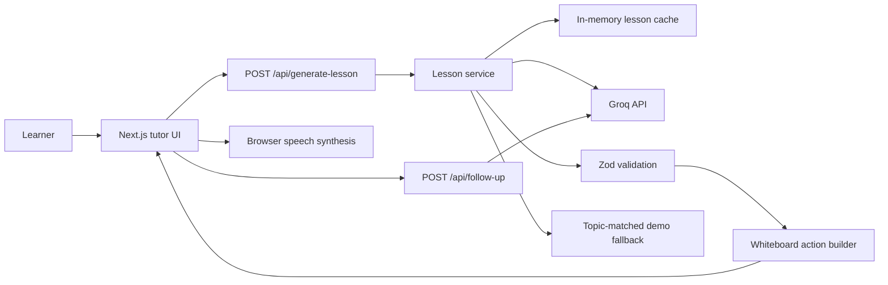

# ChalkAI

### AI-powered interactive whiteboard tutor

Turn a question into a short, visual lesson. ChalkAI explains a topic with an AI-generated lesson, browser voice narration, and whiteboard sketches that appear as the lesson plays. Learners can control playback, draw on the board, and ask follow-up questions.

## Try a lesson

Open the app and choose one of the preloaded lessons to explore the whiteboard and narration immediately. Demo lessons work without an AI key. Enter any other topic to generate a personalized lesson with Groq.

## Features

- Topic-based lessons at beginner, intermediate, or advanced level
- Groq-powered lesson generation and follow-up answers
- Browser speech synthesis for narration; no separate text-to-speech key required
- Seekable playback with pause, resume, and restart controls
- SVG whiteboard actions timed to narration, plus freehand drawing tools
- Preloaded lessons available as instant demos and AI-generation fallbacks
- Light and dark themes, responsive layouts, and lesson feedback controls
- In-memory cache for repeated topic-and-level requests

## How it works

1. The learner submits a topic and difficulty.
2. The server checks its lesson cache, then requests a structured lesson from Groq on a cache miss.
3. The app validates lesson data and builds whiteboard actions.
4. Browser speech synthesis narrates the lesson while the player reveals its visuals.
5. If AI generation fails, the app only serves a topic-matched preloaded demo. For an unmatched topic, it returns a clear temporary-unavailable message instead of presenting unrelated content.

Browser speech synthesis does not expose a consistent audio clock across browsers. ChalkAI follows spoken word-boundary events when available and uses a pause-aware estimated clock as a fallback; both the seek bar and whiteboard use that same lesson timeline.

## Architecture



## Technology

- Next.js 16 App Router, React, and TypeScript
- Groq chat completions API for lesson and follow-up generation
- Zod for request and lesson validation
- Browser Web Speech API for narration
- SVG and CSS for the interactive whiteboard and responsive interface

## Run locally

Requirements: Node.js 20 or later and npm.

```bash
npm install
```

Copy the example environment file and add a Groq API key:

```powershell
Copy-Item .env.example .env.local
```

```env
GROQ_API_KEY=your_groq_api_key
# Optional; defaults to openai/gpt-oss-20b
GROQ_MODEL=openai/gpt-oss-20b
```

Start the development server:

```bash
npm run dev
```

Then open [http://localhost:3000](http://localhost:3000). Preloaded demos work without `GROQ_API_KEY`; live generation and follow-up answers require it.

## Environment variables

| Variable | Required | Description |
| --- | --- | --- |
| `GROQ_API_KEY` | For AI features | Server-side Groq API key. Never expose it through a `NEXT_PUBLIC_*` variable. |
| `GROQ_MODEL` | No | Groq model ID; defaults to `openai/gpt-oss-20b`. |

The browser's built-in speech synthesis handles narration and needs no API credential. Keep `.env.local` private; `.gitignore` excludes local environment files.

## Demo lessons and caching

The welcome panel includes ready-to-play lessons about the water cycle, black holes, and flight. These preloaded lessons require no AI request. If live generation fails, a topic-matched demo can be served and is labeled as a fallback. If no demo matches, the API returns a temporary-unavailable error rather than teaching an unrelated topic.

Successful AI-generated lessons are cached in server memory for 10 minutes, keyed by normalized topic and difficulty, with a maximum of 50 entries. The player identifies cache hits; repeat the same topic and level to demonstrate one. AI failures, invalid responses, missing configuration, and connection timeouts trigger a labeled fallback only when a topic-matched preloaded lesson exists. Otherwise, the API reports that generation is temporarily unavailable and suggests trying again or choosing a preloaded lesson.

The cache is best-effort and process-local: it clears when the server restarts and is not shared between serverless instances. Use a shared cache such as Redis if cross-instance persistence is needed in production. Lesson feedback controls are currently session-only and are not submitted to a backend.

## Deploy

**Vercel (recommended):** Import the GitHub repository; Vercel detects Next.js and builds it automatically. Add `GROQ_API_KEY` and, optionally, `GROQ_MODEL` under the project’s Environment Variables, then deploy.

**Render or Railway:** Create a Node.js web service from the repository. Use Node.js 20+, run `npm ci` to install dependencies, `npm run build` to build, and `npm run start` to serve the app. Add the same environment variables in the provider’s service settings.

For any host, keep the Groq key server-side, verify the deployed URL, and remember that free-plan Groq rate limits still apply. The in-memory cache may not be shared across serverless instances. Browser narration uses voices available on the learner’s device.

## Quality checks

```bash
npm test
npm run lint
npm run build
```

The automated tests cover lesson schema validation, timeline scheduling, and AI-unavailable fallback selection. Voice timing still depends on browser speech synthesis; validate playback on the target desktop and mobile browsers before release.

## Project structure

- `src/app/page.tsx` — studio entry page
- `src/components/tutor-studio.tsx` — chat, lesson generation, and playback controls
- `src/components/whiteboard.tsx` — animated lesson visuals and drawing tools
- `src/data/demo-lessons.ts` — preloaded lessons and fallback content
- `src/lib/lesson-visuals.ts` — shared lesson-to-whiteboard visual generation
- `src/lib/groq.ts` — server-side Groq API client
- `src/services/lesson.service.ts` — lesson generation, cache, and fallback selection
- `src/app/api/generate-lesson/route.ts` — lesson generation endpoint
- `src/app/api/follow-up/route.ts` — follow-up tutor endpoint
- `src/schemas/lesson.schema.ts` — validated lesson and whiteboard action types
